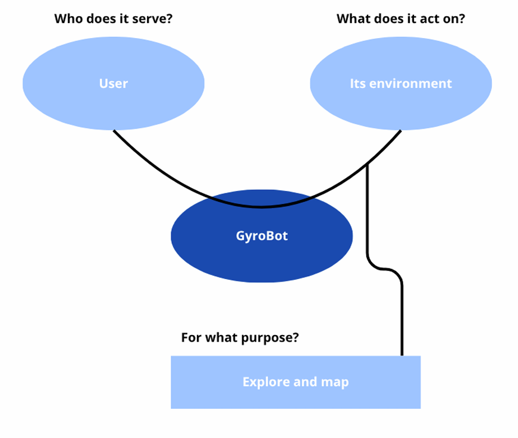
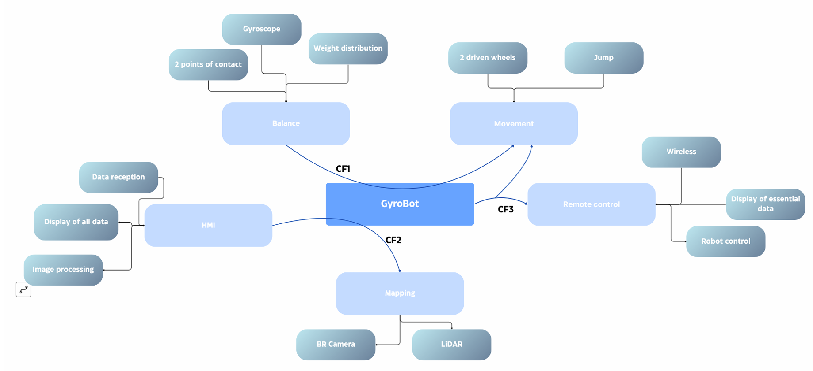
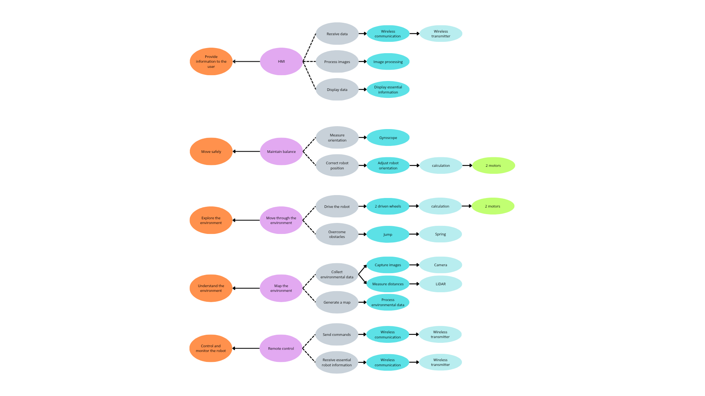
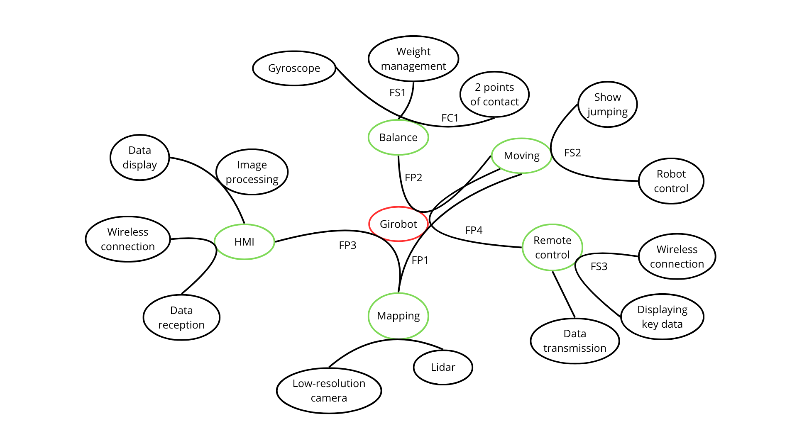

**Use Case**

The goal of this project is to create an exploration and mapping robot. This system is designed to meet the needs of two main types of users. First, it can be used by the military as a guide for reconnaissance missions and topographic surveys on rough terrains. Second, it is highly useful for architects and the construction industry to map the inside of buildings and to help organize spaces. The main problem this robot solves is the ability to easily access and map areas that are usually hard to reach.

The user will pilot the robot with a remote and will not have to worry about keeping it balanced. The interaction with the system works through two different interfaces. The pilot uses a wireless remote control to manage the movements of the robot, make it jump over obstacles, and check essential data. At the same time, a computer interface will receive the data wirelessly. This computer software will process the images and display the detailed maps created by the onboard camera and the Lidar sensor.

To make all of this possible, the robot must operate under specific technical constraints. The robot moves on only two wheels which makes it more maneuverable in small and tight places. To stay perfectly stable on its two contact points, it uses a gyroscope and carefully manages its own weight. The robot is also designed to drive on different types of outdoor surfaces like grass and dirt. The system must be compact with a height of about thirty centimeters and it needs to have a battery life of at least forty minutes to complete its missions.

**Functional Analysis**

In this project, the product is a two-wheeled robot that can either operate autonomously or be remotely controlled. The robot is configured and monitored through a Human-Machine Interface (HMI) that we designed and developed ourselves.

The main objective of this project is to enable a user to explore an unknown environment using the robot and to create a map of this environment through our HMI. The robot is equipped with several sensors, including a LiDAR and a camera, which allow it to collect information about its surroundings. This data is then transmitted to the HMI, where it can be processed and displayed to the user.

The HMI provides the user with an overview of the robot's environment and allows them to monitor important information, control the robot remotely, and visualize the generated map. The project therefore combines robotics, autonomous navigation,  data processing, image processing, and human-machine interaction.

<u><i>fig 1 : Functional Analysis Diagram (Horned Beast Diagram)</i></u>

<u>*fig 2 : Functional Interaction Diagram (Octopus Diagram)*</u>

| Reference  | Constraint function | Critical | Level |  |
| ----- | ----- | ----- | ----- | ----- |
| CF1 | Maintain balance during movement | High | ≥ 10 min |  |
| CF2 | Map its environment | Medium | ≥ 10 min |  |
| CF3 | Be remotely controlled | High | ≥ 5 m |  |

**FMEA Table**

FMEA is an analysis table that helps us figure out what could go wrong when our robot is exploring. Since the robot only uses two wheels, keeping its balance and staying connected to the remote are extremely important. This table lists the main problems the system might face. We give each risk a score based on how bad it is (Severity), how often it happens (Frequency) and how hard it is to spot (Detection). This will help us to focus on the biggest dangers so we can figure out the best ways to prevent them.

| Risks | Potential Effects | Probable Causes | G | F | D | C | Preventive Actions |
| :--- | :--- | :--- | :--- | :--- | :--- | :--- | :--- |
| *Computer overload or balancing system failure* | The robot stops balancing and crashes, breaking the Lidar and camera. | The robot's microcontroller gets too busy processing maps and images causing a small freeze that stops the balancing system. | 4 | 3 | 4 | 48 | Use two separate microcontrollers: a small one just to keep the robot balanced and another one for the map and camera. |
| *Wheels slipping* | The robot falls right away. If the wheels slide, the robot cannot balance itself and will get damaged. | Driving on mud, wet grass or loose dirt. The two wheels need a good grip on the ground to keep the robot upright. | 4 | 3 | 2 | 24 | Use tires with strong grip. Add physical stands that drop down to catch the robot if it starts to slip. |
| *Falling down stairs or holes* | The robot breaks completely, destroying the expensive sensors. | The Lidar only looks straight ahead and cannot see holes or stairs. The robot drives over the edge. | 4 | 2 | 2 | 16 | Rely on the real-time camera video feed on the HMI so the pilot can visually detect stairs and drop-offs. Mount the camera with a slight angle to maximize ground visibility. |
| *Losing connection to the remote* | The user cannot control the robot anymore, and the computer stops receiving the map. | The robot is too far away or thick walls block the signal. | 3 | 2 | 2 | 12 | Make the robot stop moving automatically if it loses the signal. Show the connection strength on the screen. |
| *Battery dying too fast* | The robot turns off and gets stuck in an area you cannot reach before the 40 minutes are over. | Driving on tough surfaces like thick grass or mud uses too much energy. | 3 | 2 | 2 | 12 | Show the battery level on the remote and make it flash red when it is almost empty. |
| *Map system not working* | The robot cannot create the map or show it on the computer screen. | Something is blocking the Lidar sensor, or the computer software crashes. | 2 | 1 | 2 | 4 | Put a protective cover over the sensors and test the computer software many times. |

**Legend:**
* *G (Severity)*: 1 to 4
* *F (Frequency)*: 1 (Rare) to 4 (Frequent)
* *D (Non-Detection)*: 1 (Immediately detectable) to 4 (Hard to predict)
* *C (Criticality)* = G × F × D

*fig 3 : FAST Diagram*

*fig 4 : Octopus_Diagram (à revoir)*

# Service Functions Characterization - GyroBot

| **Service function** | **Criteria** | **Level** | **Tolerance** |
| :--- | :--- | :--- | :--- |
| **Mapping (FP1) : Capture the user's environment** | Map accuracy / precision | 5 cm | ± 5cm |
| | Lidar (.LAS) range | 10m | ± 2m |
| **Moving (FP2) : The robot must be able to move within the environment so that mapping (FP1) is usable** | Slip | None | / |
| | Tip-over / Fall | None | / |
| | Speed | 4 km/h | ± 2 km/h |
| | Minimum turning radius (at 4 km/h) | 0.5 m | ± 0.2m |
| **HMI (FP3) : An HMI must display the information sent back by the robot in real-time** | Display latency | < 100 ms | / |
| | Map refresh rate | 2 Hz | ± 1 Hz |
| **Remote control (FP4) : Must allow the robot to be controlled remotely** | Radio control range | > 30 m (interior) | / |
| | | > 150 m (exterior) | / |
| | Command response time | < 50 ms | / |
| **Balance (FC1) : The robot must balance itself on 2 wheels** | Maximum climbable slope | > 30° | / |
| **Weight management (FS1) : The robot's weight must be properly distributed** | Center of Gravity (CoG) position | Centered, above the wheel axis | / |
| | Maximum total weight | < 1 kg | / |
| **Show jumping (FS2) : The robot must be able to jump in order to overcome obstacles** | Maximum obstacle height | 20 cm | ± 5cm |
| | Success rate of landing without falling | 80% | ± 10% |
| **Wireless connection (FS3) : Data transmission must be wireless** | Minimum bandwidth from the robot to remote control | > 30 kbps | / |
| | Minimum bandwidth from the robot to the HMI | > 2 Mbps | / |
| | Frequency | Wi-Fi 2.4 GHz | / |

<u>*fig 5 : Flow chart*</u>