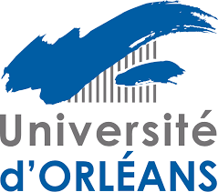
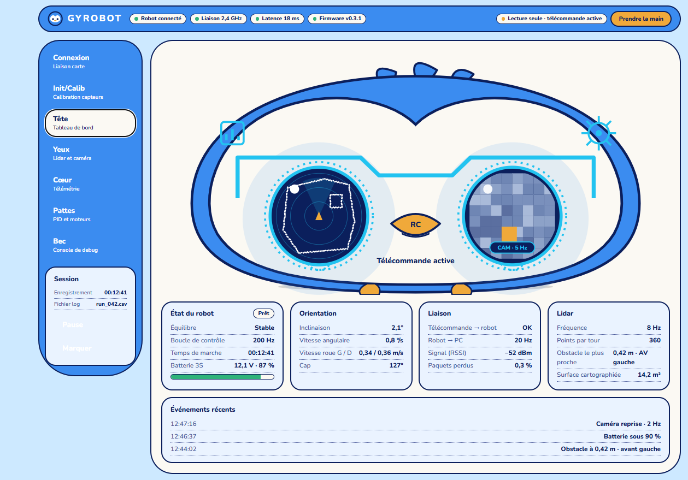
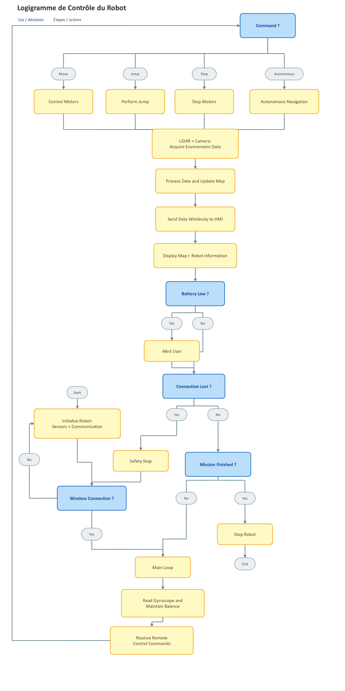

{width="4.156944444444444in"
height="1.2909722222222222in"}{width="2.165277777777778in"
height="1.9131944444444444in"}Cas d'usage Gyrobot

{width="2.6875in" height="2.7708333333333335in"}

Alexandre Vanpeperstraëte\--Bourgueil

Isam Ben Haddou

Maud Haas Quentin Legros

Simon Drapeau Professeurs à Polytech en spécialité GPSE

4A GPSE

# Glossaire :

# Sommaire {#sommaire .TOC-Heading}

[Glossaire : [1](#glossaire)](#glossaire)

[Introduction : [3](#introduction)](#introduction)

[1. Description général du robot
[4](#description-général-du-robot)](#description-général-du-robot)

# Introduction :

Dans le cadre de notre 4^ème^ année en école d'ingénieur au sein de
Polytech orléans, nous avons à réaliser un projet parmi ceux donnés ou
en proposer un nous-même. Nous avons donc proposé de réaliser un robot
tenant en équilibre sur deux roues à l'aide d'un gyroscope, le Gyrobot.

C'est un robot compact à deux roues et à équilibrage automatique, conçu
pour fonctionner dans des environnements où la mobilité,
l\'accessibilité et la navigation autonome peuvent poser des
difficultés.

Le projet vise à explorer la conception d\'une petite plateforme
robotique légère, capable de maintenir son équilibre sur deux roues,
tout en servant de base à de futures applications telles que la
cartographie, l\'exploration et l\'assistance dans des environnements
difficiles.

Au cours de ce rapport, nous allons aborder la description générale du
robot, l'expérience utilisateur, le fonctionnement algorithmique, le cas
d'usage, et enfin le Gantt.

# 1. Description général du robot

Le robot peut être séparé en 3 grandes parties:

{width="2.6875in" height="2.7708333333333335in"}

Figure 1: ébauche 3D du gyrobot

La partie basse du robot, les moteurs, les roues et les ''jambes'', noté
**1** sur l'image ci-dessous. Cette partie doit être robuste afin de
pouvoir résister à la plus par des différents types de terrains ainsi
qu'aux chocs générés par le déplacement du robot.

La partie du milieu du robot, noté **2**, contient les différents
composants nécessaires aux déplacements, à l'équilibre et au traitement
des données du lidar. Il comporte aussi la batterie nécessaire au
fonctionnement du robot. La plus grosse problématique de cette partie
sera la gestion du poids et sa répartition.

La partie haute du robot, noté **3,** contiendra un outil nécessaire à
la cartographie. Cette partie devra comprendre à minima 2 outils
différents afin de rendre le robot plus polyvalent.

Le projet comprend aussi une IHM afin d'afficher les données transmises
et traité par le robot.

# 2. Expérience utilisateur

Cette partie se concentre sur ce que l'utilisateur doit faire pour
utiliser notre produit.

## 2.1. Caractéristique nécessaire de la carte

Le Gyrobot devra se déplacer cartographier, traiter les données et les
renvoyer vers une IHM. Il devra aussi recevoir les commandes nécessaires
au déplacement du robot. C'est pourquoi nous avons fait le choix de
prendre 2 cartes afin d'éviter une potentiel surcharge de données s'il
n'y avait qu'une seule carte.

Une carte devra gérer les commandes liées aux déplacements du robot.
Celle-ci doit donc :

-   Pouvoir émettre sans fils les commandes nécessaires aux déplacements

-   Renvoyer les données tel que la vitesse, l'inclinaison du robot par
    rapport au sol et la batterie restante

-   Résister à la chaleur

-   Être d'une taille assez petite

-   Être économe en termes d'énergie

La deuxième carte devra gérer le traitement des données liées à la
cartographie ainsi que les envoyer vers notre IHM. Elle devra donc :

-   Avoir une force de calcul suffisante nécessaires au traitement des
    données du lidar

-   Pouvoir communiquer sans fils avec l'IHM

-   Résister à la chaleur

-   Être d'une taille assez petite

-   Être économe en termes d'énergie

Différentes cartes s'offrent à nous, un Arduino, une ESP 32, Raspberry
PI, STM 32 et une tennsy.

C'est pourquoi nous avons finalement choisi la carte Raspberry PI5 pour
le traitement des données et une ESP32 pour les commandes de
déplacements du robot.

## 2.2. IHM

Nous devons aussi mettre au point une IHM afin d'afficher ce que renvoie
le robot.

L'image ci-dessous a été créer avec en partie l'aide d'une IA
générative.

{width="6.3in" height="4.398611111111111in"}

Figure 2: image de l\'IMH

L'IHM comprendra plusieurs parties/onglet afin de contrôler les
différentes valeurs et les données du lidar renvoyées par le robot.
Cette IHM ressemblant à un pingouin est un choix de notre équipe et est
purement esthétique.

La présentation ainsi que les données affichées dans l'IHM sont
susceptibles de changer.

# 3. Fonctionnement algorithmique

## {width="4.933333333333334in" height="8.338194444444444in"}3.1. Flow chart

Figure 3: algorigramme du gyrobot

Cet algorigramme explique le fonctionnement algorithmique du programme.

# 4. cahier des charges

Je peux maintenant réaliser le cahier des charges sous forme de tableau
afin de le rendre plus visuel :

# {width="8.188888888888888in" height="3.5118055555555556in"}5. Retro planning (Gantt)

Figure 4: image du Gantt (mis à jour le 21/09/2026)

Ce planning sera mis à jour au fur et à mesure que nous avancerons sur
le projet. Au niveau organisation, notre plus gros problème est le fait
que nous n'avons que 3 mois pour réussir à créer un prototype. Cela nous
pousse à avoir une organisation assez pointue et exigeante.

# 6. Tests de validation et analyse fonctionnelle

## 6.1. Analyse fonctionnelle

### 6.1.1. Bête à corne

{width="5.741821959755031in"
height="4.916161417322835in"}

Le diagramme bête à corne permet de connaître clairement le besoin d\'un
utilisateur avant de concevoir un produit ou un service. Dans noter cas,
notre besoin est de cartographier et faire d'en faire une carte, le tout
grâce au Gyrobot. Il sera contrôlé par un utilisateur sur différents
environnement, intérieur comme extérieur.

### 6.1.2. Diagramme pieuvre

6.1.3. Diagramme FAST

Grâce au digramme pieuvre, nous obtenons le diagramme FAST.

{width="6.522727471566054in"
height="7.039335083114611in"}

Figure 5: diagramme FAST

Le diagramme FAST nous permet de partir de notre besoin jusqu'aux
solutions techniques.

## 6.2. Test de validations

Afin d'éviter de construire entièrement le robot et de constater qu'il
ne marche pas sans savoir pourquoi, il nous faut mettre des tests de
validations afin de tester chaque grosse partie du robot séparément.

Voici les différents tests mis en place :

-   Test de connexion

-   ...

# 7. RSE

Dans le but de la Responsabilité Sociétale des Entreprises, nous avons
mis en place des certains dispositifs afin de réduire notre impact
écologique.

# Conclusion

Pour conclure, ce projet va être très exigent, surtout au niveau du
temps. Néanmoins, notre équipe a montré un vif investissement, ce qui
nous pousse à tenir et réussir notre objectif de réaliser un prototype
avant la fin du semestre.
