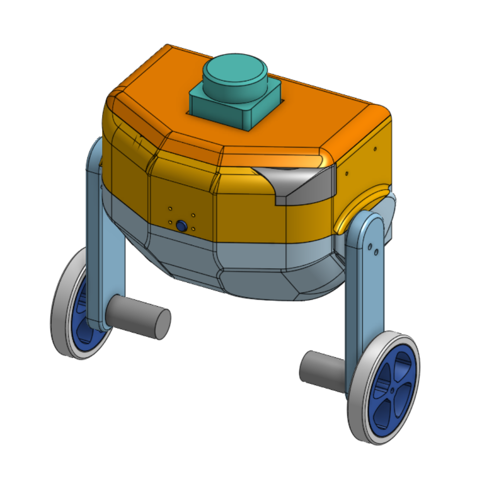
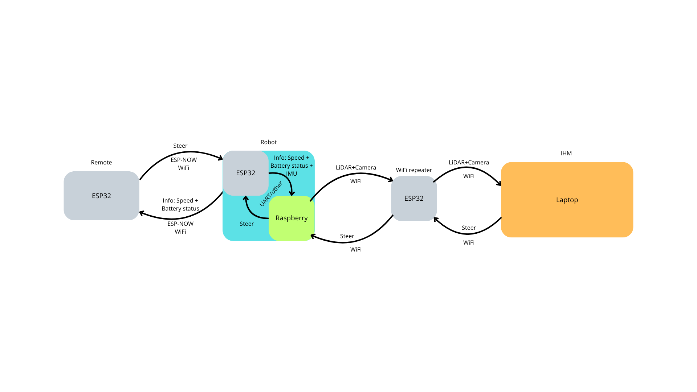

# GyroBot

<p align="center">
  
</p>

## Overview

**GyroBot** is a compact two-wheeled self-balancing robot designed to operate in environments where mobility, accessibility and autonomous navigation can be challenging.

The project focuses on developing an agile robotic platform combining dynamic balance control with spatial perception (LiDAR and camera), backed by a dedicated remote controller, a wireless repeater node, and a supervisory monitoring station.

## System Architecture

<p align="center">
  
</p>

The overall system is organized around four cooperating elements:

* **Robot**: Dual-architecture platform powered by an ESP32 for high-frequency balance and motor control (cascade PID at 200 Hz), coupled with a Raspberry Pi for onboard perception (LiDAR, camera) and telemetry transmission.
* **Remote Controller**: A custom handheld controller based on an ESP32, featuring dual joysticks, an OLED display, and dedicated controls for responsive manual steering via ESP-NOW / Wi-Fi.
* **Wi-Fi Repeater**: An autonomous ESP32 wireless relay node deployed to extend transmission range between the robot and the ground station in complex indoor layouts.
* **HMI / Ground Station**: A laptop dashboard displaying real-time environmental maps, sensor telemetry, battery status, and operating metrics.

## Key Targets & Specifications

| Requirement | Current Target | Description / Constraints |
| --- | --- | --- |
| Architecture | 2 coaxial wheels | Inverted pendulum dynamic balance |
| Dimensions & Weight | ~30 cm height, < 1.5 kg | Compact, lightweight chassis |
| Control Loop | 200 Hz (5 ms) | Dual-loop cascade PID (angle stability + velocity drift) |
| Perception | LiDAR + Camera | Environmental mapping (target accuracy ~5 cm) |
| Communication | 2.4 GHz (ESP-NOW / Wi-Fi) | Low-latency steering (< 50 ms) & telemetry |

## Current Progress

* **Functional & Risk Analysis**: Requirements definition, functional breakdown (FAST, Horned Beast, Octopus diagrams), and failure mode analysis (FMEA).
* **Dynamic Simulation**: Webots physics simulation with sensor and motor controllers (`Simulation/`).
* **Hardware Prototyping & Balance Bench**: Physical prototype with ESP32-C6, MPU6050 IMU, motor drivers, and a real-time Wi-Fi cascade PID tuning tool (`Repeteur/Code/`).
* **Remote Controller Design**: Circuit schematic, component selection, and 3D enclosure modeling (`Remote/`).
* **Validation & Test Protocols**: Comprehensive test plan (`Documentation/markdown/TestRobot.md`) covering wireless range, response latency, mapping precision, and balance robustness.

## Project Structure

```text
GyroBot/
├── Datasheet_LiDAR/                   # LiDAR technical datasheets and protocols
├── Documentation/                     # Specifications, reports, and architecture
│   ├── Excel/                         # Project tracking and functional matrices
│   ├── HMI/                           # Web interface mockups and assets
│   ├── Images/                        # Functional diagrams and system schemes
│   ├── markdown/                      # Analysis reports (FMEA, CSR, test plans)
│   └── rapport/                       # Project deliverables and use cases
├── Remote/                            # Dedicated remote controller
│   └── 3D/                            # Enclosure CAD models and renders (V1, V2)
├── Repeteur/                          # Prototype chassis and balance bench
│   ├── 3D/                            # Test bench mechanical parts
│   └── Code/                          # Validation firmware & Wi-Fi PID tuning tools
├── Robot/                             # Main GyroBot platform
│   ├── 3D/                            # Robot CAD files and renders (V1, V2)
│   ├── Code/                          # Embedded firmware (IMU, encoders, drivers)
│   └── motor_and_elec_schematic/      # Electrical wiring diagrams and motor specs
└── Simulation/                        # Webots simulation environment
    ├── controllers/                   # Robot control programs (C++)
    └── worlds/                        # Simulation scenes and environment models
```