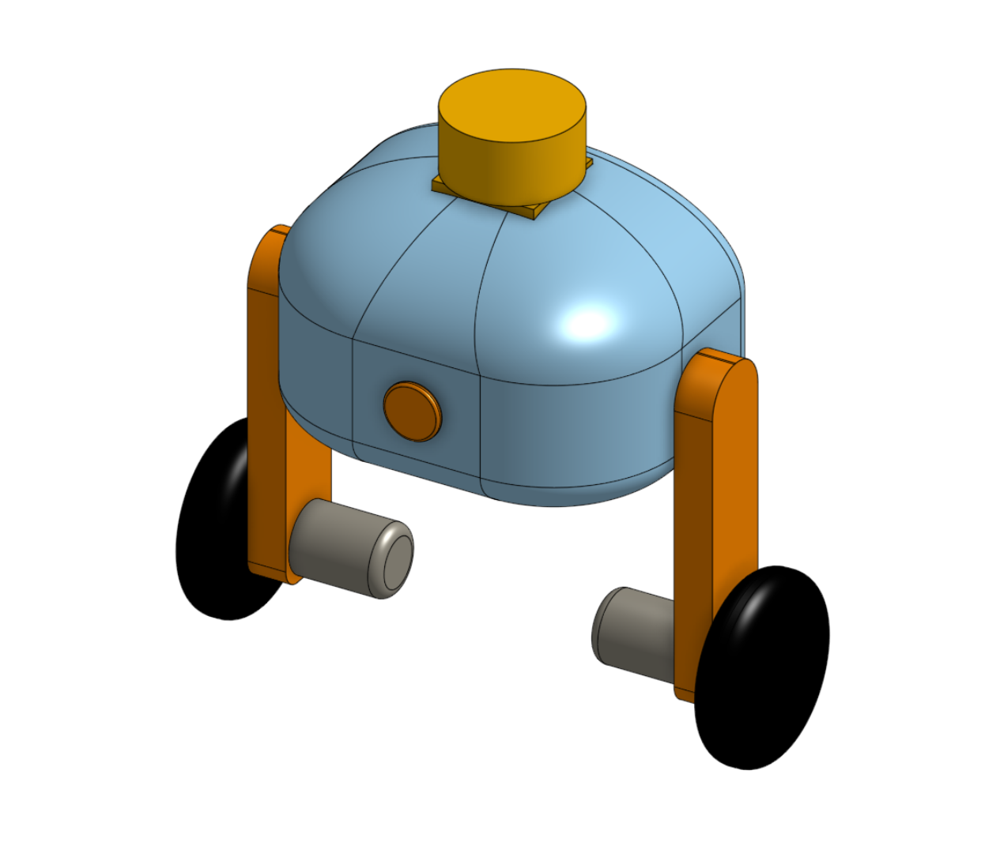

# GyroBot

<p align="center">
  
</p>

## Overview

**GyroBot** is a compact two-wheeled self-balancing robot designed to operate in environments where mobility, accessibility and autonomous navigation can be challenging.

The project aims to explore the design of a small, lightweight robotic platform capable of maintaining its balance on two wheels, while providing a base for future applications such as mapping, exploration and assistance in difficult environments.

At this stage, GyroBot is still in its early conceptual phase. The current work focuses mainly on functional analysis, risk assessment and the definition of the robot's overall architecture and requirements.

## Potential Applications

Several applications are being considered for GyroBot:

### Mapping and Construction

GyroBot could be used to create maps or collect spatial information in buildings and other environments.

Potential applications include:

* Supporting architects and construction companies
* Surveying buildings and construction sites
* Collecting environmental or spatial data
* Inspecting areas that are difficult to access

###  Search and Rescue

Its compact size and two-wheeled configuration could allow GyroBot to access areas that are difficult or unsafe for humans.

Possible applications include:

* Search and rescue operations
* Exploration after disasters
* Inspection of unstable structures
* Assistance in hazardous or inaccessible environments

###  Hostile and Hazardous Environments

A future version of GyroBot could potentially be equipped with sensors adapted to environments that are dangerous for humans.

Examples include:

* Military or conflict environments
* Radioactive areas
* Industrial hazardous zones
* Contaminated environments
* Other areas where remote exploration is preferable

> These applications are currently **conceptual goals** and do not represent the capabilities of the current prototype.

## Main Objectives

The current objective is to develop a small and lightweight self-balancing robotic platform.

| Requirement      | Current Target               |
| ---------------- | ---------------------------- |
| Number of wheels | 2                            |
| Height           | ~20 cm                       |
| Weight           | < 1 kg                       |


The dimensions and weight targets are preliminary and may evolve as the project progresses.

## Current Progress

The project is currently at the **preliminary design stage**.

So far, we have worked on:

* Functional analysis
* Identification of the main functions of the robot
* FAST diagram
* "Horned Beast" functional analysis
* Pieuvre diagram
* Risk analysis
* Initial definition of project requirements
* Preliminary 3D modelling

The current 3D model is **not a final design**. It is a simple first version intended to estimate the overall size, proportions and general appearance of the robot.

## Project Structure


```text
GyroBot/
│
├── README.md
|
├── Gantt.xlsx
│
├── Documentation/
│   ├── Images/
│   │   
│   └── Diagrammes.md
│
└── 3D/
    ├── V1_Images/
    |
    └── V1_stl/
```


The `Documentation` folder contains the analyses and diagrams produced during the preliminary design phase.


The `Gantt.xlsx` file contains the Gantt chart for beginning of the project.

The `3D/V1` folder contains the first conceptual 3D model and pictures of GyroBot.